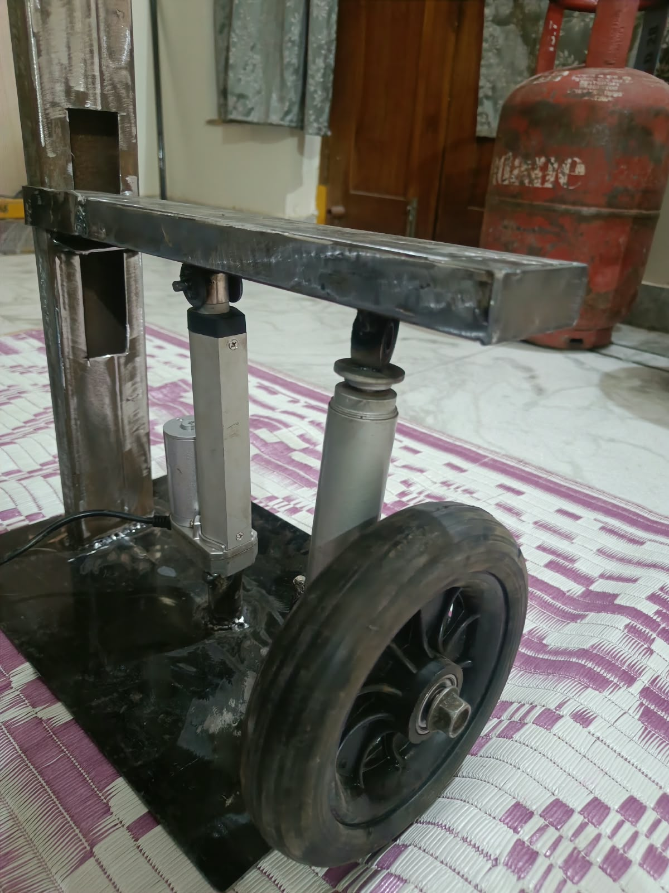

# Intelligent Active Suspension System

A physical prototype exploring actuator-assisted vehicle suspension, combining mechanical fabrication with a foundation for future embedded control and suspension-performance testing.

## Project Overview

Traditional passive suspension systems use fixed mechanical characteristics, creating a trade-off between ride comfort, vehicle stability, and road handling. This project explores an actuator-assisted suspension system that could provide more adaptable suspension behavior.

The project focuses on developing a laboratory-scale, single-wheel suspension test bench as a platform for studying suspension movement, mechanical integration, and future closed-loop control.

## Prototype

The physical prototype was fabricated to explore the mechanical arrangement of a wheel, suspension mechanism, actuator, and supporting frame.

### Prototype — Initial View

### Prototype — Alternate View

## Key Components

- **Wheel assembly:** Represents the wheel-side mechanical assembly.
- **Suspension strut and shock absorber:** Provides the suspension mechanism for the prototype.
- **12V linear actuator:** Explores the possibility of actuator-assisted suspension adjustment.
- **Fabricated metal frame and base:** Supports the assembly and its mounting points.
- **Mechanical linkages and joints:** Connect the components within the prototype structure.

## Design and Development

The development process involved exploring the mechanical layout, component positioning, mounting arrangements, and practical fabrication constraints.

Moving from a conceptual design to a physical assembly helped expose challenges that are not always obvious in a digital model, particularly alignment, clearances, mounting geometry, and mechanical movement.

## Current Project Status

**Completed:** Physical prototype fabrication and mechanical assembly.

**Planned / under development:** Integration and validation of the embedded control and measurement system, including STM32, an MPU6050 inertial measurement unit, actuator driver electronics, PID control, and a Python/Streamlit monitoring interface.

These control and monitoring features are part of the proposed development roadmap and should not be interpreted as validated functionality unless separately implemented and tested.

## Future Work

1. Integrate the microcontroller, sensors, and actuator driver.
2. Implement and tune a PID controller for suspension experiments.
3. Record sensor measurements and actuator behavior during repeatable tests.
4. Develop a dashboard for monitoring, visualization, and data logging.
5. Compare passive and actively controlled responses using measurable performance indicators.

Machine-learning-based control and road-profile prediction are potential later extensions, after collecting and validating experimental data.

## What I Learned

This project provided practical exposure to taking an engineering idea beyond a digital concept and into physical fabrication. It encouraged me to consider real-world constraints, component integration, mounting geometry, and the gap between a design that looks correct and a mechanism that works reliably.

## Project Information

- **Project:** Intelligent Active Suspension System
- **Type:** Physical engineering prototype
- **Application area:** Automotive suspension and embedded control
- **Institution:** KL Deemed to be University, Department of ECE

---

*This is a laboratory-scale prototype intended for engineering exploration and development, not a road-ready vehicle suspension system.*
